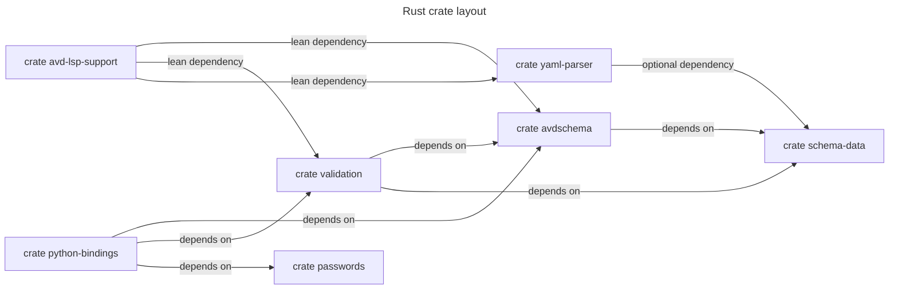

<!--
  ~ Copyright (c) 2025-2026 Arista Networks, Inc.
  ~ Use of this source code is governed by the Apache License 2.0
  ~ that can be found in the LICENSE file.
  -->



## Lean avdschema features

AVD schemas use a deliberately restricted regular-expression dialect.
`avdschema` supports Unicode-aware Perl classes (`\d`, `\s`, and `\w`, including
their uppercase complements), Unicode-safe wildcards and explicit character
classes, lookarounds, and variable-length lookbehinds. Broader Unicode
properties and scripts such as `\p{Greek}` are intentionally unsupported.
Patterns are matched against the complete value. The default features
additionally enable native performance accelerators, gzip loading, and YAML file
support.

The AVD language server consumes these crates through `avd-lsp-support`. That
crate exposes the exact schema, validation, and YAML parser API used by the LSP
and owns its lean feature selection:

```toml
avd-lsp-support = { version = "0.0.8", default-features = false }
```

Native LSP consumers can enable its `gzip` feature when needed. The browser
WASM build should retain the empty default feature set.

The optional `schema-data` feature on `yaml-parser` implements the shared
`schema-data` views for YAML values. Validation and the LSP enable this feature;
standalone parsing does not need it. It does not enable `avdschema` features.
Consumers select gzip, YAML file support, and performance accelerators directly
on their `avdschema` dependency. Unicode-aware Perl classes and variable-length
lookbehinds are always enabled.
