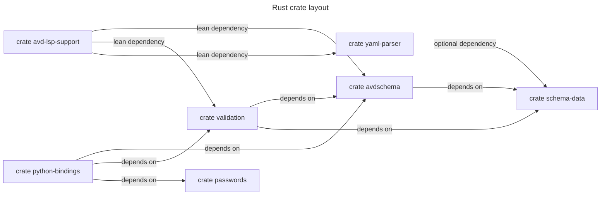

<!--
  ~ Copyright (c) 2025-2026 Arista Networks, Inc.
  ~ Use of this source code is governed by the Apache License 2.0
  ~ that can be found in the LICENSE file.
  -->



## Lean avdschema features

AVD schemas use a deliberately restricted regular-expression dialect.
`avdschema` supports Unicode-aware Perl classes (`\d`, `\s`, and `\w`, including
their uppercase complements), Unicode-safe wildcards and explicit character
classes, lookarounds, and variable-length lookbehinds. Broader Unicode
properties and scripts such as `\p{Greek}` are intentionally unsupported.
Patterns are matched against the complete value. The default features
additionally enable native performance accelerators, gzip loading, and YAML file
support.

The AVD language server consumes these crates through `avd-lsp-support`. That
crate exposes the exact schema, validation, and YAML parser API used by the LSP
and owns its lean feature selection:

```toml
avd-lsp-support = { version = "0.0.8", default-features = false }
```

Native LSP consumers can enable its `gzip` feature when needed. The browser
WASM build should retain the empty default feature set.

The optional `schema-data` feature on `yaml-parser` implements the shared
`schema-data` views for YAML values. Validation and the LSP enable this feature;
standalone parsing does not need it. It does not enable `avdschema` features.
Consumers select gzip, YAML file support, and performance accelerators directly
on their `avdschema` dependency. Unicode-aware Perl classes and variable-length
lookbehinds are always enabled.

## Benchmarks

Run the Criterion-compatible benchmark suites locally from the repository root:

```bash
cargo bench --locked --workspace --all-features
```

The suites use the small, checked-in schema fixture at `tests/schemas/schemas.json`.
These microbenchmarks do not characterize full AVD schema startup.
Schema benchmarks measure compilation and compiled archive mapping separately;
validation and Python benchmarks check successful coercion before measurement.
The generated interface inputs emphasize coercion of numeric descriptions.

Build and smoke-test each CodSpeed measurement mode separately:

```bash
cargo install cargo-codspeed --version 5.0.1 --locked
cargo codspeed build --locked --workspace --all-features --measurement-mode simulation
cargo codspeed run --workspace --measurement-mode simulation
cargo codspeed build --locked --workspace --all-features --measurement-mode memory
cargo codspeed run --workspace --measurement-mode memory
```

Outside a CodSpeed runner, these run commands only smoke-test the harness;
the Linux CI action collects and uploads measurements.

Simulation measures CPU work; memory analysis reports allocation metrics rather
than process RSS. Python-boundary results include the Rust allocations observed
by CodSpeed, and do not represent the full Python interpreter memory footprint.
The GitHub workflow builds and uploads each mode in an independent job after the
Rust test matrix succeeds, so one mode can finish even if the other fails.
